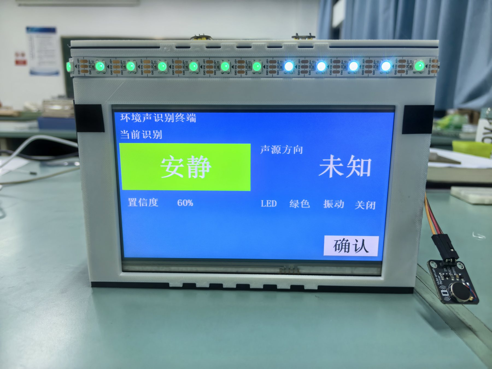
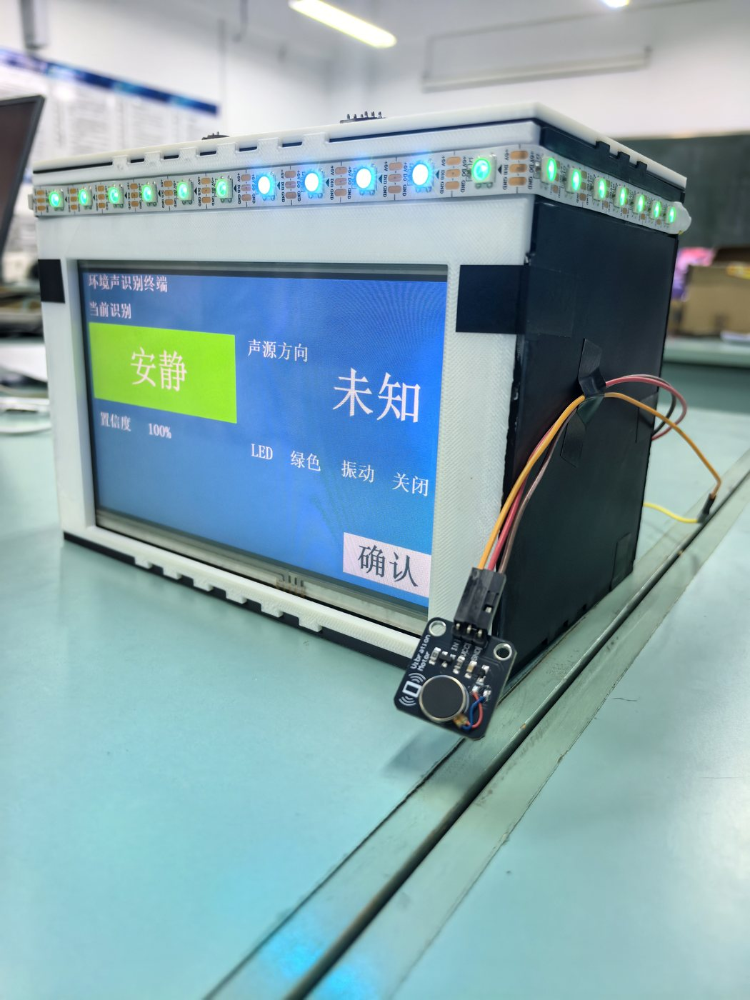

# Zynq-7020 离线多麦克风环境声识别终端

本目录是 2026 FPGA 创新设计赛道 AMD 3.3 自主命题方向的最终整理包。作品在正点原子启明星 Zynq-7020 上完成四麦克风同步采集、PL 端 49×40 Log-Mel 特征、PS 裸机 INT8 DS-CNN 推理、四向声源提示、陶晶驰串口屏、WS2812 灯带、5 V 振动马达和屏幕确认消警闭环。

> 这是公开工程目录。不要将签字承诺书、报名表或包含个人联系方式的材料放入仓库。

## 当前最终运行组合

- PL：`build/artifacts/stage29_retry_tjc.bit`
- PS：`build/artifacts/stage37_model_candidate.elf`
- 启动方式：板载 QSPI 脱机启动；JTAG 仅用于开发和恢复
- 工具：Vivado / Vitis 2025.2
- 芯片：Zynq-7020（xc7z020）

这套组合对应最后一次板上联调、8/8 主机回归和 60 秒静态噪声浸泡。`board/boot/` 中的 BIF、镜像和冷启动日志记录了 Stage29 + Stage37 脱机启动组合；文件哈希见根目录 `SHA256SUMS.txt`。

## 已完成结果

- 四个 INMP441 在 16 kHz 下同步采样。
- PL 生成一秒 49×40 无符号 Log2 Q8.8 特征矩阵。
- PS 裸机运行 8 输出 INT8 DS-CNN；class 6 仅保留 ABI，产品出口映射为 unknown。
- 敲门增加 220/255 置信度、PCM 峰值/均值、峰均比和活跃帧数门控。
- 紧急警报需连续 3 次确认；修复了紧急分支绕过确认计数的问题。
- 类别、方向、灯色和马达按同一事件发布；无同事件有效方向时屏幕留空。
- 屏幕确认只清除已确认告警，并带最小保持和冷却时间。
- 固定样本回归 8/8 通过。
- 60 秒静态环境监测 120 次采样，非零动作 0 次。
- 路由后 WNS 11.184 ns、TNS 0 ns，全部用户时序约束满足。
- 最终程序已固化到 W25Q256，断开下载工具后可上电自动运行。

## 目录

- `src/rtl/`：I2S、帧缓存、窗函数、FFT、Mel、Log-Mel、快照与灯带 RTL。
- `src/ps/`：最终 PS 应用、INT8 模型、方向估计与串口屏驱动。
- `src/constraints/`：板级 XDC。
- `src/vivado/`：Vivado 工程、Block Design 和关键 IP 描述。
- `build/artifacts/`：Stage29 最终 bitstream 与 Stage37 ELF。
- `build/reports/`：时序、资源与 DRC 报告。
- `data/`：模型指标、8/8 回归和噪声浸泡证据。
- `model/stage36_candidate_v1/`：乙回传的训练代码、量化参数、INT8 C 导出和验证摘要；为控制仓库体积，未附逐层向量文件。
- `tests/`：完整功能验收表及 hard-negative 采集/回传脚本。
- `board/`：Stage37 启动镜像、BIF、JTAG 下载脚本和板测日志。
- `docs/`：架构、接口、接线和复现说明。
- `report/`：2026-11-04 更新的技术报告 PDF。
- `mechanical/`：外壳与麦克风底板设计文件，目录说明见 `mechanical/README.md`。
- `docs/images/product/`：README 使用的整机正面与侧面照片。

## 快速复现

1. 按 `docs/hardware_setup.md` 检查四麦、屏幕、灯带、马达和共地。
2. JTAG 下载 `stage29_retry_tjc.bit`。
3. 运行 `board/jtag/run_latest_elf.ps1` 下载 Stage37 ELF。
4. 按 `tests/full_acceptance/acceptance_results.csv` 逐项测试。
5. 使用根目录 `SHA256SUMS.txt` 核对文件完整性。

## 结果边界

模型指标来自开发/回归样本，不能当作独立现场准确率。方向功能会受房间反射、扬声器位置和阵列安装误差影响，因此未虚构统计准确率。当前版本优先保证完整闭环、低静态误报和可复现性。

## 许可证

本队原创源代码和文档按 MIT License 交付；AMD/Xilinx IP、工具生成文件、公开数据和第三方材料仍遵循各自许可证。
