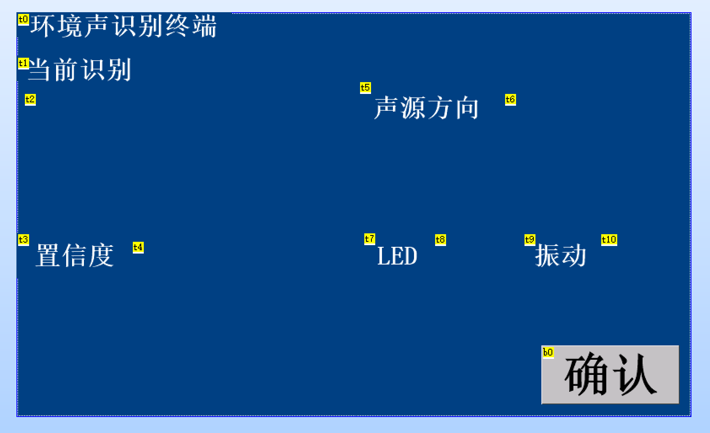

# Software and hardware interface

## Model ABI

Input is `int8[1][49][40]` in frame-major order. The C convolution code views it as one input channel. The output contains eight logits with the fixed IDs below.

| ID | Name | Product behavior |
|---:|---|---|
| 0 | silence | no alarm |
| 1 | unknown | no alarm |
| 2 | knock | blue indication |
| 3 | alarm_clock | yellow indication |
| 4 | alarm_alert | red emergency indication |
| 5 | baby_cry | yellow indication |
| 6 | glass_break | ABI placeholder, mapped to unknown |
| 7 | kettle | blue indication |

The PL matrix is unsigned Log2 Q8.8. `main_stage29.c` converts it to the natural-log domain used by model training, then applies the model input quantizer. The retry path recomputes features from synchronized PCM only when the base result is unknown.

## HMI fields

The TJC page receives the current class, confidence percentage, direction, alarm action, and motor-enabled state. Firmware sends dependent physical-output and direction fields before revealing a new class so the user does not see a new label paired with stale state at 9600 baud.

## Direction interface

The direction estimator consumes four synchronized signed 16-bit PCM channels. It publishes a validity bit and one of four cardinal sectors. Invalid or low-energy results are shown as blank rather than reusing the previous direction.

## Model replacement contract

A replacement model must preserve the 49 x 40 signed-int8 input, eight outputs, class IDs, rounding behavior, and `dscnn.h` API. Replace `src/ps/model/dscnn_model_data.h` and, if required, `dscnn.c/.h`; then run the fixed host regression before rebuilding the ARM ELF.

